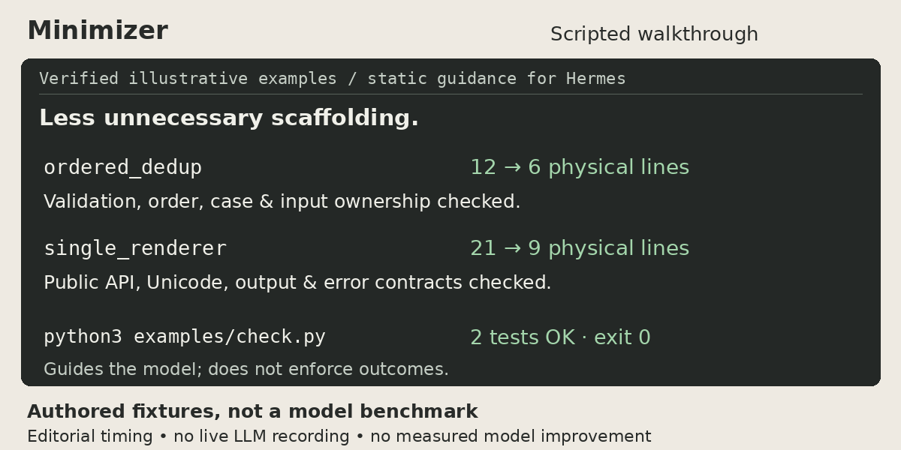

# Hermes Minimizer

Less unnecessary scaffolding, with all required behavior intact.

[](https://github.com/nosliwhtes/hermes-minimizer/actions/workflows/ci.yml)
[](https://hermes-agent.nousresearch.com/docs/)
[](LICENSE)

Minimizer adds one static guidance section to Hermes: reuse what fits, avoid speculative layers, and prove the requested behavior. It adds no tools, hooks, scanners, telemetry, or runtime dependencies. It guides the model; it does not enforce outcomes.

## Quick start

Install the official catalog's reviewed revision:

```bash
hermes plugins install hermes-minimizer --enable
```

Start a **new Hermes session or process**, then try:

> Review this change for over-engineering without editing it. Identify unnecessary scaffolding or existing behavior we can reuse. Preserve every requirement and safeguard; explain the tests or invariants each proposed cut must preserve.

Check installation and enablement:

```bash
hermes plugins doctor hermes-minimizer --ci
hermes plugins list --enabled --plain
```

The enabled list should include `hermes-minimizer`; doctor checks native discovery and registration, not model behavior. Existing persisted prompts can retain their original section bytes.

## See the verified examples

**Scripted walkthrough of verified, authored fixtures—not a live LLM recording or a plugin-vs-baseline benchmark.**

[](docs/assets/minimizer-demo.mp4)

[Watch MP4](docs/assets/minimizer-demo.mp4) · [Animated GIF](docs/assets/minimizer-demo.gif) · [Static PNG / reduced-motion option](docs/assets/minimizer-demo.png)

## Everyday use

These are ordinary-language prompts, **not registered commands or magic activation phrases**. The guidance is present when the plugin is enabled for the session.

- “Be lazy: reuse the existing implementation if its semantics fit this requirement.”
- “Apply YAGNI here. Remove only speculative extension points, not required behavior.”
- “Review this diff for over-engineering. Suggest cuts before making changes.”

For a copyable advisory review format and a build/review workflow, see [Workflows](docs/workflows.md). No separate skill or Journey installation is required.

## Runnable evidence

**These are authored illustrative fixtures, not code mined from users or measurements of model effectiveness.** Both versions execute against the same behavioral expectations. No performance, token, or installation savings have been measured.

| Simplification | Before | After | Physical lines |
| --- | --- | --- | --- |
| Ordered string deduplication using `dict.fromkeys` | [`examples/ordered_dedup/before.py`](examples/ordered_dedup/before.py) | [`examples/ordered_dedup/after.py`](examples/ordered_dedup/after.py) | 12 → 6 (−6) |
| Remove a one-implementation renderer factory | [`examples/single_renderer/before.py`](examples/single_renderer/before.py) | [`examples/single_renderer/after.py`](examples/single_renderer/after.py) | 21 → 9 (−12) |

Run locally with stdlib Python 3.10+; no Hermes or model access is needed:

```bash
python examples/check.py
```

The verifier also works by absolute script path from another directory. It exits nonzero on failure and counts all physical source lines, including imports, comments, and blanks, using `splitlines()`. The fixtures are not imported by the plugin.

**Scope and preserved invariants:** deduplication accepts a list of strings, retains first-occurrence order and case, returns a fresh list, leaves input unchanged, and preserves type errors. The renderer keeps the public `render_message(name, *, style="plain")` entrypoint, whitespace trimming, Unicode, output, and error types/messages/order; only `plain` is supported. Its internal classes are not public API. Empty inputs, invalid types, unsupported styles, and keyword-only calling are checked. Neither example is a recommendation to remove validation or a factory with a real architectural purpose.

## Boundaries and FAQ

**What must not be simplified away?** Authorization, trust-boundary validation, security, data-loss prevention, required error handling, accessibility, calibration, migration/rollback safety, concurrency protection, compatibility, required tests, or explicitly requested behavior. System, user, and repository requirements outrank this guidance. Correctness and ownership matter more than line count.

**Is this the Minimizer skill?** No. This repository ships a native Python plugin, not a Journey kit or skill. Optional skills are separate procedures; see [plugin vs. skill](docs/workflows.md#plugin-vs-optional-skills) and [Ponytail provenance](THIRD_PARTY_NOTICES.md).

**Does it guarantee simpler or safer code?** No. It is not an authorization layer, sandbox, test runner, or policy enforcement engine. Static guidance is deterministic; model responses are not. Review changes and run the required checks.

**Enabled, but no guidance?** Start a new session/process; resumed prompts may retain frozen sections. Hermes' shared prompt-section budget (8,000 characters by default across plugins) can omit sections, and safe worker contexts may suppress plugins. Check doctor output and the consuming context, not just the enabled list.

**Older Hermes?** Requires Hermes **>=0.22.0** and `PluginContext.register_system_prompt_section`. Missing the native API fails registration visibly with an upgrade message; there is no monkeypatch or silent fallback.

## Update, disable, or remove

```bash
hermes plugins update hermes-minimizer
hermes plugins disable hermes-minimizer
hermes plugins remove hermes-minimizer
```

These are separate actions: update to refresh the installed source; disable to keep it installed but off; remove to uninstall it. Start a new session/process after a change. Disabling is config-only in a running process and does not rewrite already-persisted prompts. Re-run doctor and the enabled-list check after updating.

The catalog tracks a reviewed commit and can lag this repository's releases. For intentional branch-source installation instead, use `hermes plugins install nosliwhtes/hermes-minimizer --enable`; that is not the catalog's reviewed pin.

## Compatibility and development

Native integration has been execution-tested against official Hermes commits `e06df9c2eae6901f4c88f464e0ae6e753c0428b8` (v0.22.0) and `548091836760a67e331b8f5643be8e5c08fae1e6`. This is not a claim that every intermediate version or model was tested.

[Development commands and test setup](docs/development.md) · [Contributing](CONTRIBUTING.md) · [Changelog](CHANGELOG.md)

Feedback: open an issue with the plugin/Hermes versions, a minimal public reproducer, expected behavior, and observed checks. Remove private code, prompts, credentials, and transcripts first.

## License

[MIT](LICENSE). Copyright (c) 2026 Seth Wilson. [Third-party notices](THIRD_PARTY_NOTICES.md).
